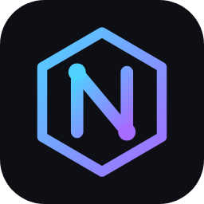

<h1 align="center">Nexo — la IA que vive en tu PC</h1>

Programa, crea webs y juegos, edita tus vídeos y habla contigo. 
Funciona en tu ordenador: privada, sin internet y gratis.

<a href="https://github.com/Neconex22/nexo/raw/main/NexoSetup.exe"><b>⬇️ Descargar Nexo para Windows (demo gratuita)</b></a>

---

### Qué hace

- **Programa de todo:** webs, juegos 2D, bots, scripts de Python, Roblox… y los convierte en `.exe`. Prueba su propio trabajo y corrige los errores.
- **Edita vídeos:** recorta, une, pasa a vertical para TikTok y pone subtítulos automáticos.
- **Privada:** funciona sin internet. Tus chats y archivos se quedan en tu disco.
- **Te recuerda:** aprende lo que le cuentas y lo usa en los siguientes chats.
- **Se actualiza sola:** cuando sale una versión nueva, se instala automáticamente.

### Instalación

1. Descarga **NexoSetup.exe** (enlace de arriba).
2. Ábrelo y pulsa **Instalar**. Se descargan unos 4 GB (el motor, el modelo de IA y ffmpeg para vídeo).
3. Abre **Nexo** desde el escritorio.

> Windows puede avisar de que la app no es conocida porque no está firmada: pulsa **Más información → Ejecutar de todas formas**.

### Demo gratuita

Todo el mundo tiene **30.000 tokens al día** (se recargan cada noche) con Nexo Auto, Nexo Chat y Nexo Code Rápido, modo agente, 100 skills, memoria y subtítulos. Los planes con más modelos llegarán pronto.

### Requisitos

| | Mínimo | Recomendado |
|---|---|---|
| Sistema | Windows 10/11 | Windows 11 |
| RAM | 16 GB | 32 GB |
| Disco libre | 15 GB | 20 GB |
| Gráfica | 6 GB | NVIDIA de 8 GB o más |

### Licencias

Nexo usa modelos de IA de código abierto que se descargan al instalar y se usan según sus licencias: Qwen3, Qwen2.5-Coder y Qwen3-Coder (Apache 2.0, Alibaba Cloud), gpt-oss (Apache 2.0, OpenAI), Gemma 3 (Gemma Terms of Use, Google), Ollama (MIT) y whisper.cpp (MIT).

Nexo · creado por neconex22

